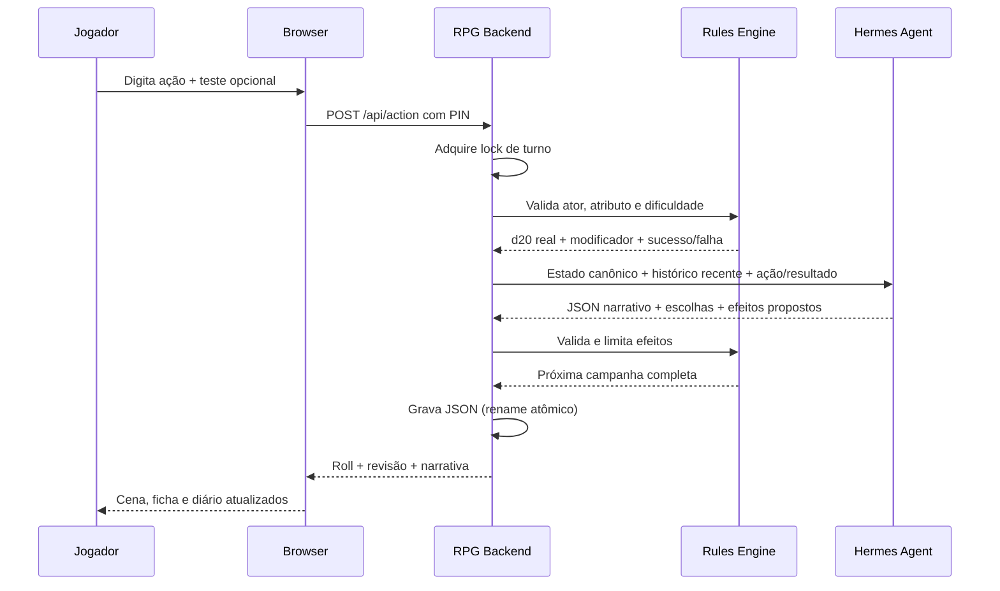

# Arquitetura e plano técnico — Hermes RPG

## Princípios

1. O Hermes atua exclusivamente como mestre/narrador, não como motor de regras.
2. Backend local mantém o estado autorizado (fichas, posição, rolagens e turnos).
3. API do Hermes permanece vinculada a `127.0.0.1`, inacessível diretamente aos jogadores.
4. Camadas de regras, interface e provedor de mestre são desacopladas.
5. O jogo deve poder ser testado sem depender de serviços externos (modo demo / mock).
6. Os dois jogadores compartilham um mundo, mas escolhem separadamente seus personagens.

## Diagrama lógico

```mermaid
flowchart TB
  A[Joe — browser] --> B[Web UI / REST]
  C[Benício — browser] --> B
  B --> D[RPG Backend — Node 20+]
  D --> E[Game Engine: regras, dados, movimento]
  D --> F[Storage local JSON atômico]
  D --> G[Hermes Adapter — OpenAI Chat Completions]
  G --> H[Hermes perfil rpg-mestre localhost:8650]
  H --> I[Provedor LLM configurado no Hermes]
```



## Fluxo de uma ação narrativa



Se Hermes não responder ou o formato for inválido, o servidor retorna erro ou usa narrativa textual sem executar instruções estruturadas. O estado da campanha anterior é preservado em caso de falha da chamada.

## Modelo de domínio

`Campaign`: `schemaVersion`, `revision`, `createdAt`, `updatedAt`, `adventure`, `scene`, `players`, `events`.

`Scene`: `title`, `objective`, `narration`, `choices[]`.

`Player`: `id`, `player`, `hero`, `emoji`, `hp`, `maxHp`, `stats {coragem,agilidade,engenho}`, `items[]`, `position{x,y}`.

`Event`: `id`, `at`, `kind=player|master`, `actor`, `text`, `roll`, `effects[]`.

`Roll`: `die 1..20`, `stat`, `modifier`, `total`, `dc`, `success`.

### Contrato LLM esperado

```json
{
  "narration": "O guardião abre os portões.",
  "title": "Entrada da Torre",
  "objective": "Encontrar a fonte da luz",
  "choices": ["Examinar as runas", "Entrar em silêncio", "Conversar com o guardião"],
  "effects": [{"actor":"benicio","hpDelta":0,"addItem":"Chave da torre"}]
}
```

- Respostas fora do esquema são reduzidas a narrativa apenas ou rejeitadas se vazias.
- `hpDelta` precisa ser inteiro [-2,+2], vida fica entre 1 e 8.
- Efeitos só podem apontar para `joe` ou `benicio`, com no máximo um bloco de efeito por personagem em cada turno.
- `addItem` tem no máximo 50 caracteres, não pode duplicar e inventário tem limite de 10 itens.
- Ações de personagens são interpretadas como texto não confiável pelo prompt; não existe execução de código ou arquivos da LLM neste serviço.

## Ferramentas e IA

O endpoint OpenAI-compatible é **stateless**: o backend reenvia estado e uma janela limitada dos últimos 12 eventos em toda ação. Este MVP não depende de `X-Hermes-Session-Id` nem de memória longa dentro do Hermes. Para campanhas longas, usar resumo persistido por capítulo e replay de eventos completo em banco de dados.

Hermes trabalha num perfil com modelo e API key próprios. Restrições de execução precisam ser definidas na configuração do perfil e, idealmente, no limite de permissões do processo/contêiner; o prompt sozinho não é uma barreira de segurança.

## Estado compartilhado e sincronização

- Revisão cresce a cada turno ou movimento.
- Navegadores verificam mudanças a cada 2,5 segundos.
- O backend admite apenas uma ação narrativa por vez. Requisições concorrentes recebem HTTP 409.
- O processo único conserva um estado em memória e grava atômica em arquivo.
- Escalonamento para múltiplos processos **não é suportado no MVP**. Antes de usar vários workers, migrar para Postgres + lock transacional.

## Aceitação (MVP)

1. Navegador não autenticado recebe HTTP 401 ao tentar ler `/api/state`.
2. Os dois personagens aparecem com vida, itens e atributos corretos.
3. Um movimento válido incrementa a revisão; paredes e movimentos longos são rejeitados.
4. Um teste d20 tem número verificado no servidor e enviado ao mestre com total correto.
5. O Hermes recebe `system + user` com estado, opções e resumo do turno via Bearer.
6. Narrativa recebida é exibida com texto seguro, sem permitir scripts no DOM.
7. Efeitos malformados ou perigosos não alteram arbitrariamente HP e inventário.
8. Segundo navegador vê o novo estado após o intervalo de atualização.
9. Reinício exige PIN separado e não pode ocorrer durante uma resposta em andamento.
10. Falha do Hermes não remove turnos anteriores da campanha.
11. Testes de regras e de integração com mock passam em `npm test`.

## Backlog priorizado

| Prioridade | Próxima entrega | Critério principal |
|---|---|---|
| P0 | Validação real na instalação Hermes do mini PC | 3 turnos consecutivos, sem erro de autenticação/schema |
| P0 | Implementar backup/exportação de campanhas | Export/restore testado sem perder eventos |
| P1 | Duas fases de teste: Hermes solicita rolagem; jogador executa | Ninguém escolhe arbitrariamente dificuldade |
| P1 | Editor de personagens e missões | Fichas ajustadas antes de iniciar e persistidas |
| P1 | Áudio TTS offline com Piper ou equivalente | Voz pt-BR sem necessidade de serviço externo |
| P2 | Streaming SSE ou WebSocket | Atualização instantânea em duas telas |
| P2 | Resumo por capítulos e estados auditáveis | Campanha com >100 turnos não perde contexto |
| P2 | Mod PlanarAlly com sincronização segura | Mapas e tokens conectados a eventos do Bridge |
| P3 | Adaptadores de regras e combate | Motor extensível com licenças verificadas |

## Limitações críticas

- O mini mapa incorporado não é uma engine de VTT avançada; não gera mapas automaticamente.
- Voz apenas TTS do navegador; não há entrada de voz nem integração com microfones/Echo.
- Escolha de atributo e dificuldade fica com jogador (simplificação para protótipo).
- O backend aceita efeitos pequenos sugeridos pelo modelo, sem aprovação de responsável.
- O PIN dá acesso à mesma identidade de jogo; não constitui autenticação de usuários distintos.
- Não foi testado nesta entrega contra um gateway Hermes físico; apenas contra mock HTTP e demo.
